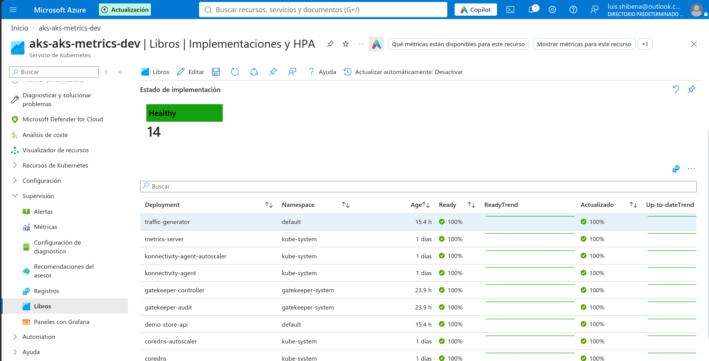
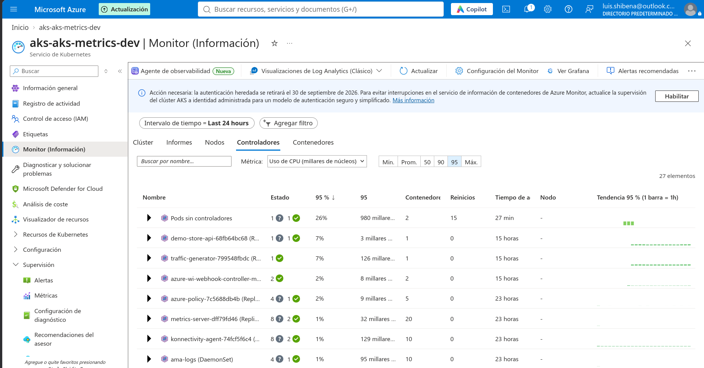
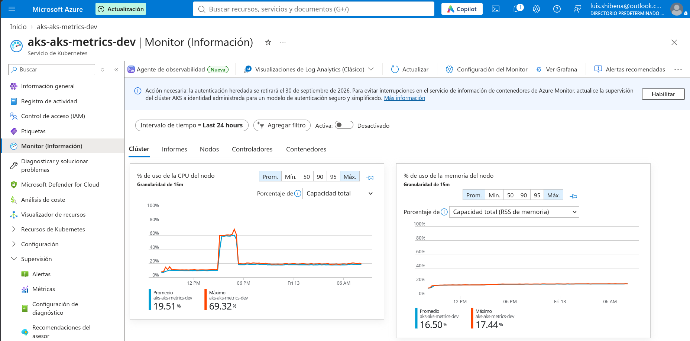
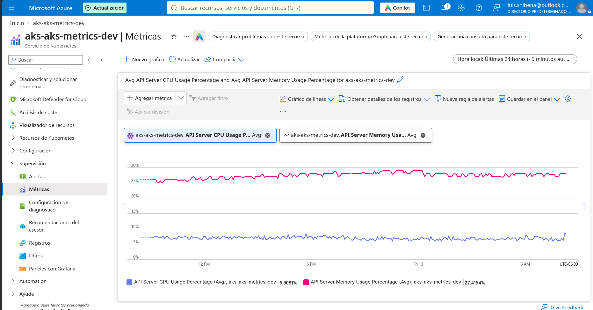

# Enterprise Azure Kubernetes Service (AKS) & Cloud-Native Observability Platform

[](https://github.com/LuisMamey/aks/actions/workflows/security.yml)
[](https://github.com/LuisMamey/aks/actions/workflows/scorecard.yml)


A production-grade, highly secure, and cost-optimized **Azure Kubernetes Service (AKS)** platform engineered entirely through **Infrastructure as Code (Terraform)**. Designed with enterprise-grade security controls (passwordless **Azure Workload Identity**, **Azure CNI Overlay**, **Ephemeral OS Disks**, **Azure Policy / Gatekeeper**), shift-left DevSecOps automation, and full-stack observability with **Azure Monitor Container Insights**.

---

## 📌 Table of Contents
1. [Platform Overview & Objectives](#-platform-overview--objectives)
2. [Cloud Architecture Reference: AWS to Azure](#-cloud-architecture-reference-aws-to-azure)
3. [Live Telemetry & Production Verification](#-live-telemetry--production-verification)
4. [Core Engineering Highlights](#-core-engineering-highlights)
5. [Architecture Decision Records (ADRs)](#-architecture-decision-records-adrs)
6. [Repository Structure](#-repository-structure)
7. [Getting Started & Reproducibility](#-getting-started--reproducibility)
8. [DevSecOps & CI/CD Pipeline](#-devsecops--cicd-pipeline)
9. [Resource Cleanup & Cost Control](#-resource-cleanup--cost-control)

---

## 🎯 Platform Overview & Objectives

### The Problem
Kubernetes deployments in cloud environments frequently run into three common operational challenges:
1. **Secret Sprawl & Credential Leaks:** Storing long-lived service principal client secrets, passwords, or connection strings inside Kubernetes Secret objects or environment variables.
2. **Subnet IP Exhaustion:** Traditional cloud CNI plugins assign dedicated private VNet/VPC IPs to every pod, rapidly depleting corporate address spaces and blocking cluster scalability.
3. **Unbounded Cloud Spend & Compliance Failure:** Deploying clusters without strict IaC static analysis (failing CIS benchmarks), leaving expensive managed OS disks running 24/7, and lacking formal architectural documentation for risk acceptance.

### The Solution: Cloud-Native AKS Blueprint
This repository delivers an **auditable, zero-trust cloud-native platform on Microsoft Azure**:
1. **Passwordless Workload Identity:** Replaces static cloud secrets with short-lived **OIDC token federation** directly between Kubernetes ServiceAccounts and Microsoft Entra ID.
2. **Azure CNI Overlay:** Isolates pod networking into an overlay CIDR (`192.168.0.0/16`), conserving enterprise VNet IP space while retaining full network policy enforcement.
3. **Automated DevSecOps Quality Gate:** Every commit is strictly evaluated by **Checkov** (zero unjustified skips), **Gitleaks** (secret detection), and **OpenSSF Scorecard** (supply-chain security).
4. **FinOps & Platform Automation:** Fully automated via `./scripts/platform.sh` — provisions infrastructure and workloads, validates federated identities, and stops nodes to **$0.00/hr compute** when idle.

### Core Engineering Capabilities

| Domain | Key Deliverables & Practical Implementation |
| :--- | :--- |
| **Infrastructure as Code (IaC)** | 100% modular Terraform with remote state locking, geo-redundancy (`GRS`), and automated format/validation pipelines. |
| **Cloud Security & Identity** | **Zero Hardcoded Secrets**. Implemented **Azure Workload Identity** with OIDC token federation for pod-to-cloud resource authorization. |
| **Kubernetes Architecture** | Configured **Azure CNI Overlay** for IP address conservation, **Ephemeral OS Disks** for near-instant boot and NVMe performance, and node pool rotation strategies. |
| **SRE & Observability** | Configured **Azure Monitor Container Insights** via Log Analytics Workspace, capturing live cluster, controller, container, and node metrics over 24+ hours of continuous traffic. |
| **Shift-Left DevSecOps** | Automated CI/CD pipeline blocking pull requests on static analysis (**Checkov** with zero unverified skips), secret scanning (**Gitleaks**), and supply-chain analysis (**OpenSSF Scorecard**). |
| **Architecture Governance** | Documented all intentional risk/cost trade-offs through formal **Architecture Decision Records (ADRs)**. |
| **Platform Automation** | End-to-end lifecycle automation (`./scripts/platform.sh up / down / status / stop / test-identity`). |

---

## 🔄 Cloud Architecture Reference: AWS to Azure

For engineering teams operating multi-cloud environments or transitioning between cloud ecosystems, here is how each core component maps between AWS and Azure:

| Capability | AWS Equivalent | Azure Implementation in this Project | Rationale / Benefits |
| :--- | :--- | :--- | :--- |
| **Kubernetes Service** | Amazon EKS | **Azure Kubernetes Service (AKS)** | Fully managed control plane with patch upgrade channels enabled. |
| **Pod Identity Federation** | IAM Roles for Service Accounts (IRSA) | **Azure Workload Identity (OIDC)** | Eliminates static credentials; pods authenticate directly to Azure Storage via short-lived JWT tokens. |
| **Container Networking** | AWS VPC CNI | **Azure CNI Overlay** | Decouples Kubernetes pod CIDR (`192.168.0.0/16`) from the Azure VNet, avoiding subnet exhaustion. |
| **Container Registry** | Amazon ECR | **Azure Container Registry (ACR)** | Connected natively via AKS Kubelet Managed Identity with `AcrPull` role (no registry secrets). |
| **Container Monitoring** | CloudWatch Container Insights | **Azure Monitor Container Insights** | Unified logging and metrics ingested into Log Analytics with pre-built Workbooks and Alert rules. |
| **IaC State Storage** | S3 + DynamoDB State Locking | **Azure Blob Storage (tfstate)** | Blob container with lease locking, TLS 1.2 enforcement, and 7-day soft-delete protection. |
| **Node Storage** | EC2 Instance Store | **Azure Ephemeral OS Disks** | OS disk hosted on the VM's local NVMe storage (`Standard_D2ds_v6`), lowering latency and eliminating managed disk fees. |

---

## 📊 Live Telemetry & Production Verification

All metrics below were captured live in Microsoft Azure after **15+ continuous hours** of automated traffic generation and pod execution:

### 1. Workload Health & Rolling Availability (Healthy: 14)
The AKS cluster maintained **100% availability** across all 14 managed deployments, including user applications (`demo-store-api` and `traffic-generator`), CoreDNS, Azure Policy Gatekeeper, and Metrics Server.



### 2. Workload Controllers & Zero-Secret Identity Architecture
Live Container Insights dashboard highlighting active workloads, zero unexpected restarts, and the active `azure-wi-webhook-controller-manager` ensuring real-time JWT token injection.



### 3. Node Resource Optimization & Stability (24-Hour Horizon)
Average CPU utilization remained at **19.51%** with memory utilization at **16.50%** on the `Standard_D2ds_v6` node, proving optimal pod resource limits and sizing.



### 4. Managed Kubernetes Control Plane Telemetry
API Server telemetry streamed to Azure Monitor showing healthy CPU (~6.9%) and memory (~27.4%) consumption on the managed control plane.



---

## 🚀 Core Engineering Highlights

### 1. Zero Secrets via Azure Workload Identity & OIDC
Static cloud credentials (API tokens, passwords, connection strings) stored in Kubernetes secrets represent significant security liabilities. This project integrates **Azure Workload Identity**:
* AKS is provisioned with an **OIDC Issuer URL**.
* A Kubernetes `ServiceAccount` (`workload-identity-sa`) is annotated with the `azure.workload.identity/client-id`.
* An Azure User-Assigned Managed Identity (`id-aks-metrics-dev-app`) defines a **Federated Identity Credential** linked to the Kubernetes ServiceAccount.
* Pods exchange temporary projected service account tokens (`/var/run/secrets/azure/tokens`) directly with Entra ID to access Azure Storage with **`Storage Blob Data Reader`** RBAC roles without secrets.

### 2. Ephemeral OS Disks for Performance and Cost
Instead of attaching network-provisioned Azure Managed OS Disks (which incur disk IOPS latency and monthly storage fees), the cluster utilizes **Ephemeral OS Disks** hosted directly on the virtual machine's local NVMe scratch storage (`Standard_D2ds_v6`). This provides:
* Sub-millisecond node re-imaging and scaling.
* High read/write IOPS throughput.
* Zero billing cost for dedicated OS managed disks.

### 3. Azure CNI Overlay Architecture
Standard Azure CNI assigns an IP from the virtual network's subnet to every single Kubernetes pod, causing rapid VNet IP exhaustion. This deployment leverages **Azure CNI Overlay**:
* Nodes receive private VNet IPs (`10.10.1.0/24`).
* Pods are assigned private overlay IPs (`192.168.0.0/16`) routed across nodes via VXLAN encapsulation.
* Solves IP exhaustion while retaining native Azure Network Policy and NSG enforcement.

### 4. Pod Scheduling & Resource Tuning on Dev Quotas
In single-node development environments constrained by subscription quota (4 vCPUs), Azure system add-ons (Log Analytics DaemonSet, CNS, Gatekeeper, OIDC Webhook) reserve ~1.8 vCPUs. By tuning application pod requests to `10m` CPU and `32Mi` memory, application pods schedule reliably without triggering Kubernetes `FailedScheduling: Insufficient cpu`.

---

## 📜 Architecture Decision Records (ADRs)

Following enterprise governance standards, all architectural decisions, compliance exceptions, and cost-vs-security trade-offs are documented under [`docs/adr/`](docs/adr/):

| ADR | Title | Status | Scope & Checkov Rules Managed |
| :--- | :--- | :--- | :--- |
| [**0001**](docs/adr/0001-bootstrap-state-hardening-scope.md) | Terraform Remote State Backend Hardening | Accepted | Hardens state storage (TLS 1.2, GRS, 7-day soft delete, SAS policy); scopes public access for local CLI workflows. |
| [**0002**](docs/adr/0002-aks-security-scope.md) | AKS Cluster Security & Cost Scope | Accepted | Implements ephemeral OS, network policies, patch upgrade channel; documents dev-tier control plane trade-offs. |
| [**0003**](docs/adr/0003-acr-tier-and-security-scope.md) | Azure Container Registry (ACR) Tier Scope | Accepted | Analyzes Basic vs. Premium SKU cost ($5 vs $50/mo), enforcing passwordless RBAC (`AcrPull`) and shift-left scanning. |
| [**0004**](docs/adr/0004-demo-http-inbound-scope.md) | Public Inbound HTTP Scope for Demo Workload | Accepted | Explains public HTTP port 80 accessibility for load-balancer metrics demonstration without custom domain overhead. |

---

## 📁 Repository Structure

```text
.
├── .github/
│   ├── dependabot.yml              # Automated dependency vulnerability scanning
│   └── workflows/
│       ├── scorecard.yml           # OpenSSF Supply-Chain Security Analysis
│       └── security.yml            # CI Security Gate: Gitleaks, Terraform Fmt/Validate, Checkov IaC SAST
├── .pre-commit-config.yaml         # Local developer pre-commit hook (Gitleaks)
├── bootstrap/                      # Remote Terraform state backend infrastructure
│   ├── main.tf                     # Storage Account, Container, SAS Policy, Soft-delete
│   └── outputs.tf                  # Backend storage account and container outputs
├── docs/
│   ├── adr/                        # Architecture Decision Records (ADR 0001 - 0004)
│   └── images/                     # Production telemetry evidence and screenshots
├── k8s/                            # Kubernetes workload manifests
│   ├── demo-workload.yaml          # Nginx API Deployment, LoadBalancer Service, Traffic Generator
│   └── workload-identity-demo.yaml # Workload Identity ServiceAccount and verification Pod
├── scripts/
│   └── platform.sh                 # Automated platform lifecycle automation (up/down/status/stop)
├── terraform/                      # Core AKS infrastructure stack
│   ├── acr.tf                      # Azure Container Registry (Basic SKU, RBAC AcrPull)
│   ├── aks.tf                      # AKS Cluster (Standard_D2ds_v6, Ephemeral OS, CNI Overlay, OIDC)
│   ├── identity.tf                 # User Assigned Identity & Federated Credential for Workload Identity
│   ├── locals.tf                   # Common tags and naming conventions
│   ├── main.tf                     # Resource Group definition
│   ├── monitoring.tf               # Log Analytics Workspace (LAW)
│   ├── network.tf                  # VNet, Subnet, and Network Security Group
│   ├── outputs.tf                  # Infrastructure connection outputs
│   ├── providers.tf                # Azurerm provider (~> 5.13) & remote backend config
│   ├── terraform.tfvars.example    # Variable templates for reproducibility
│   └── variables.tf                # Parameter declarations (subscription, region, environment)
├── LICENSE                         # MIT License
├── SECURITY.md                     # Security and vulnerability reporting policy
└── README.md
```

---

## 🛠 Getting Started & Reproducibility

### Prerequisites
* [Azure CLI (`az`)](https://learn.microsoft.com/en-us/cli/azure/install-azure-cli) `v2.60+`
* [Terraform](https://developer.hashicorp.com/terraform/downloads) `v1.5+`
* [kubectl](https://kubernetes.io/docs/tasks/tools/) `v1.30+`
* Active Azure Subscription with at least 4 vCPUs quota in `eastus2`.

### Option A: Automated One-Command Lifecycle (Recommended)
This platform includes a complete lifecycle automation script `./scripts/platform.sh`:

```bash
# Provision everything (bootstrap state + AKS infrastructure + workloads):
./scripts/platform.sh up

# Inspect live cluster health, nodes, pods, and public HTTP endpoint:
./scripts/platform.sh status

# Verify zero-secret Workload Identity OIDC federation:
./scripts/platform.sh test-identity

# Pause AKS nodes to drop compute cost to $0.00/hr:
./scripts/platform.sh stop

# Resume paused AKS cluster:
./scripts/platform.sh start

# Complete teardown of all Azure resources:
./scripts/platform.sh down
```

---

### Option B: Manual Step-by-Step Reproduction

#### Step 1: Bootstrap the Remote State Backend
```bash
az login
cd bootstrap
terraform init
terraform apply
```
*Take note of the created Storage Account name.*

### Step 2: Deploy Infrastructure with Terraform
```bash
cd ../terraform
cp terraform.tfvars.example terraform.tfvars
# Edit terraform.tfvars with your Azure Subscription ID
terraform init
terraform plan
terraform apply
```

### Step 3: Connect to AKS Cluster
```bash
az aks get-credentials \
  --resource-group rg-aks-metrics-dev \
  --name aks-aks-metrics-dev \
  --overwrite-existing

kubectl get nodes -o wide
```

### Step 4: Deploy Kubernetes Workloads
```bash
cd ../k8s
kubectl apply -f demo-workload.yaml
kubectl apply -f workload-identity-demo.yaml

# Check running pods and services
kubectl get pods -o wide
kubectl get svc demo-store-svc
```

### Step 5: Test Passwordless Workload Identity
Access the verification pod and authenticate to Azure without entering any credentials:
```bash
kubectl exec -it azure-identity-demo -- sh

# Inside pod:
az login --federated-token "$(cat $AZURE_FEDERATED_TOKEN_FILE)" \
  --service-principal \
  -u "$AZURE_CLIENT_ID" \
  -t "$AZURE_TENANT_ID"

# List storage account containers via Azure RBAC:
az storage container list \
  --account-name <YOUR_STORAGE_ACCOUNT_NAME> \
  --auth-mode login \
  -o table
```

---

## 🛡 DevSecOps & CI/CD Pipeline

Every commit and pull request must clear the automated GitHub Actions **Security Gate**:

1. **Gitleaks (`v8.30.1`):** Complete repository scan ensuring zero API keys, secrets, or certificates are committed.
2. **Terraform Format & Validate:** Enforces canonical HCL formatting (`terraform fmt -check`) and static syntax validation across `terraform/` and `bootstrap/`.
3. **Checkov IaC SAST (`v3.3.16`):** Scans all Terraform code for compliance against CIS benchmarks and cloud security best practices. Suppressions are accepted strictly if mapped to a documented ADR.
4. **OpenSSF Scorecard:** Weekly and on-push supply-chain security analysis scanning for token permissions, branch protections, and pinned dependencies.

---

## 🧹 Resource Cleanup & Cost Control

To avoid unnecessary cloud expenditure when not actively evaluating or running the cluster:

### Option A: Stop Cluster (Preserves configuration and state, stops VM billing)
```bash
az aks stop --resource-group rg-aks-metrics-dev --name aks-aks-metrics-dev
```
*To resume later: `az aks start --resource-group rg-aks-metrics-dev --name aks-aks-metrics-dev`.*

### Option B: Complete Teardown (Destroys all provisioned resources)
```bash
cd terraform
terraform destroy -auto-approve

cd ../bootstrap
terraform destroy -auto-approve
```

---

## 📄 License
This project is licensed under the [MIT License](LICENSE).
